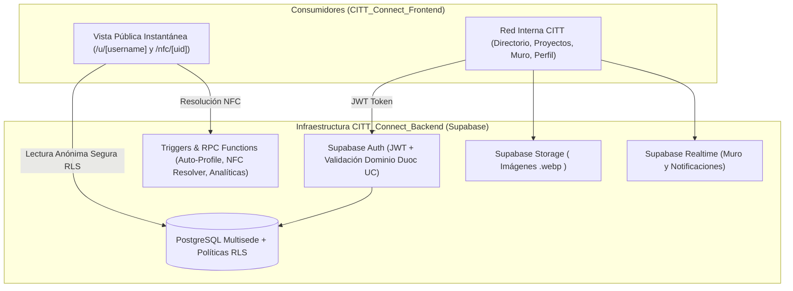

# 01. Arquitectura Backend y Configuración de Supabase

> **Repositorio:** `CITT_Connect_Backend`
> **Motor Principal:** Supabase (PostgreSQL 15+, GoTrue Auth, Supabase Storage, Realtime & Edge Functions).

---

## 1. Rol del Backend en CITT Connect

El backend de **CITT Connect** está diseñado bajo una arquitectura **Multisede y NFC-Ready** que abastece tanto la experiencia pública sin fricción (lectura instantánea de perfiles vía QR o Pin NFC sin exigir inicio de sesión al visitante) como la **Red Interna Nacional de los CITT de Chile** (directorio filtrable por sede/escuela/track, showcase de proyectos inter-sedes, muro de noticias y sistema de insignias).



---

## 2. Flujo de Autenticación y Gobernanza Institucional

Para garantizar que **CITT Connect** sea una red confiable y exclusiva de miembros reales de los CITT de Chile, el backend implementa dos capas de validación:

1. **Restricción de Dominio Institucional:**
   * Solo se permite el registro con correos terminados en:
     * `@duocuc.cl` (Estudiantes y ayudantes)
     * `@profesor.duoc.cl` (Docentes y coordinadores)
     * `@duoc.cl` (Administrativos y directivos)
   * Implementado mediante un *Auth Hook* o *Trigger* de validación en PostgreSQL antes de insertar en `auth.users` / `public.profiles`.
2. **Sistema Oficial de 6 Roles (`citt_role`):**
   * `personal_duoc`: Rango institucional más alto (Coordinadores CITT, Docentes y Directivos Duoc UC).
   * `lider_citt`: Autoridad interna estudiantil/técnica dentro de cada sede CITT (Capitanes, Líderes de área).
   * `consejero_carrera`: Perfiles puente que mantienen contacto directo entre el CITT y los alumnos de Duoc UC que aún no poseen cuenta en CITT Connect.
   * `usuario_citt`: Miembros activos de cualquier carrera que integran la comunidad CITT.
   * `partner`: Rol exclusivo para empresas o aliados externos que publican anuncios, desafíos u oportunidades para los CITT.
   * `dev`: Desarrolladores y administradores técnicos de la plataforma CITT Connect.

---

## 3. Arquitectura "NFC-Ready" en el Backend

Aunque la fabricación de los **Pines NFC impresos en 3D** se realizará en la **Fase 4** (cuando se cuente con los materiales físicos), el backend deja resuelta toda la infraestructura lógica desde la Fase 1:

* **Desacoplamiento entre el Chip Físico y el Username:**
  * Nunca se graba directamente el nombre del usuario en el chip NFC si se desea reutilizar o reasignar pines, o bien se soporta tanto `/u/[username]` como `/nfc/[tag_uid]`.
  * La tabla `public.nfc_tags` mapea cualquier `tag_uid` físico hacia un `profile_id` activo.
* **Función RPC `resolve_nfc_tag(p_tag_uid text)`:**
  * En una sola llamada atómica, verifica que el tag esté `active`, inserta un registro en `public.profile_views` con `source = 'nfc_tap'`, actualiza `last_scanned_at` y devuelve el `username` del miembro para redirigir instantáneamente.

---

## 4. Variables de Entorno Requeridas

Para conectar `CITT_Connect_Frontend` o scripts de administración con este backend:

```env
# URL del proyecto en Supabase
NEXT_PUBLIC_SUPABASE_URL="https://[PROJECT_REF].supabase.co"

# Clave pública (Anon Key) — Segura para el cliente gracias a las políticas RLS
NEXT_PUBLIC_SUPABASE_ANON_KEY="eyJhbGciOiJIUzI1NiIsInR5cCI6IkpXVCJ9..."

# Clave de servicio (Service Role Key) — EXCLUSIVA para migraciones o administración backend
SUPABASE_SERVICE_ROLE_KEY="eyJhbGciOiJIUzI1NiIsInR5cCI6IkpXVCJ9..."
```
