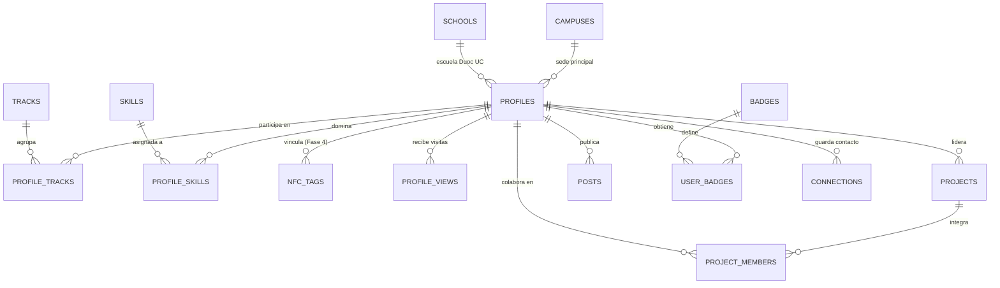

# 02. Esquema de Base de Datos y Script SQL Inicial

> **Repositorio:** `CITT_Connect_Backend`
> **Base de Datos:** PostgreSQL 15+ (Supabase)

---

## 1. Diagrama Entidad-Relación (ERD)



---

## 2. Script SQL Completo (`001_initial_schema.sql`)

Este script está listo para ejecutarse en el **SQL Editor de Supabase** o mediante `supabase db push`. Incluye la creación de tablas, índices y la carga inicial (*Seed*) de las **Escuelas Oficiales del Kit Digital Duoc UC**, **Sedes** y **Tracks CITT**.

```sql
-- ============================================================================
-- CITT CONNECT - MIGRACIÓN INICIAL DE BASE DE DATOS (SUPABASE / POSTGRESQL)
-- ============================================================================

-- Extensiones necesarias
CREATE EXTENSION IF NOT EXISTS "pgcrypto";

-- 1. TIPOS ENUMERADOS (ENUMS)
CREATE TYPE public.citt_role_type AS ENUM (
  'miembro',
  'lider_track',
  'capitan',
  'coordinador_docente',
  'alumni'
);

CREATE TYPE public.nfc_tag_status AS ENUM (
  'active',
  'unassigned',
  'lost',
  'disabled'
);

CREATE TYPE public.view_source_type AS ENUM (
  'gallery',
  'qr_scan',
  'nfc_tap',
  'direct_link',
  'search'
);

CREATE TYPE public.project_status_type AS ENUM (
  'idea',
  'en_desarrollo',
  'prototipo',
  'finalizado'
);

CREATE TYPE public.post_category_type AS ENUM (
  'noticia',
  'evento',
  'hackathon',
  'logro',
  'convocatoria',
  'ayuda_tecnica'
);

-- ============================================================================
-- 2. TABLAS CATÁLOGO INSTITUCIONALES (SEDES, ESCUELAS DUOC UC, TRACKS, SKILLS)
-- ============================================================================

-- 2.1 Sedes Duoc UC con presencia CITT
CREATE TABLE public.campuses (
  id UUID PRIMARY KEY DEFAULT gen_random_uuid(),
  name TEXT NOT NULL,
  slug TEXT NOT NULL UNIQUE,
  region TEXT NOT NULL,
  is_active BOOLEAN NOT NULL DEFAULT true,
  created_at TIMESTAMPTZ NOT NULL DEFAULT now()
);

-- 2.2 Escuelas Oficiales (Kit Digital Duoc UC)
CREATE TABLE public.schools (
  id UUID PRIMARY KEY DEFAULT gen_random_uuid(),
  name TEXT NOT NULL,
  slug TEXT NOT NULL UNIQUE,
  css_class TEXT NOT NULL,
  primary_hex VARCHAR(7) NOT NULL,
  secondary_hex VARCHAR(7) NOT NULL,
  created_at TIMESTAMPTZ NOT NULL DEFAULT now()
);

-- 2.3 Tracks / Líneas de Desarrollo CITT
CREATE TABLE public.tracks (
  id UUID PRIMARY KEY DEFAULT gen_random_uuid(),
  name TEXT NOT NULL,
  slug TEXT NOT NULL UNIQUE,
  description TEXT,
  icon_name TEXT NOT NULL DEFAULT 'cpu',
  created_at TIMESTAMPTZ NOT NULL DEFAULT now()
);

-- 2.4 Habilidades y Tecnologías (Skills)
CREATE TABLE public.skills (
  id UUID PRIMARY KEY DEFAULT gen_random_uuid(),
  name TEXT NOT NULL UNIQUE,
  slug TEXT NOT NULL UNIQUE,
  category TEXT,
  created_at TIMESTAMPTZ NOT NULL DEFAULT now()
);

-- ============================================================================
-- 3. NÚCLEO DE IDENTIDAD (PERFILES DE MIEMBROS CITT)
-- ============================================================================

CREATE TABLE public.profiles (
  id UUID PRIMARY KEY REFERENCES auth.users(id) ON DELETE CASCADE,
  username TEXT NOT NULL UNIQUE,
  full_name TEXT NOT NULL,
  institutional_email TEXT NOT NULL UNIQUE,
  public_email TEXT,
  avatar_url TEXT,
  headline TEXT,
  bio TEXT,
  citt_role public.citt_role_type NOT NULL DEFAULT 'miembro',
  campus_id UUID REFERENCES public.campuses(id) ON DELETE SET NULL,
  school_id UUID REFERENCES public.schools(id) ON DELETE SET NULL,
  career TEXT,
  admission_year INT,
  linkedin_url TEXT,
  github_url TEXT,
  portfolio_url TEXT,
  phone_optional TEXT,
  current_company TEXT, -- Especialmente útil para estado 'alumni'
  is_open_to_collaborate BOOLEAN NOT NULL DEFAULT true,
  is_verified BOOLEAN NOT NULL DEFAULT false,
  is_public BOOLEAN NOT NULL DEFAULT true,
  created_at TIMESTAMPTZ NOT NULL DEFAULT now(),
  updated_at TIMESTAMPTZ NOT NULL DEFAULT now()
);

CREATE INDEX idx_profiles_username ON public.profiles(username);
CREATE INDEX idx_profiles_campus ON public.profiles(campus_id);
CREATE INDEX idx_profiles_school ON public.profiles(school_id);
CREATE INDEX idx_profiles_role ON public.profiles(citt_role);

-- Relación N:M entre Perfiles y Tracks CITT
CREATE TABLE public.profile_tracks (
  profile_id UUID NOT NULL REFERENCES public.profiles(id) ON DELETE CASCADE,
  track_id UUID NOT NULL REFERENCES public.tracks(id) ON DELETE CASCADE,
  is_primary BOOLEAN NOT NULL DEFAULT false,
  PRIMARY KEY (profile_id, track_id)
);

-- Relación N:M entre Perfiles y Skills
CREATE TABLE public.profile_skills (
  profile_id UUID NOT NULL REFERENCES public.profiles(id) ON DELETE CASCADE,
  skill_id UUID NOT NULL REFERENCES public.skills(id) ON DELETE CASCADE,
  PRIMARY KEY (profile_id, skill_id)
);

-- ============================================================================
-- 4. HARDWARE NFC (PREPARADO PARA FASE 4) Y ANALÍTICAS DE NETWORKING
-- ============================================================================

CREATE TABLE public.nfc_tags (
  id UUID PRIMARY KEY DEFAULT gen_random_uuid(),
  tag_uid TEXT NOT NULL UNIQUE,
  profile_id UUID REFERENCES public.profiles(id) ON DELETE SET NULL,
  status public.nfc_tag_status NOT NULL DEFAULT 'unassigned',
  pin_batch TEXT DEFAULT 'v1-sandwich-3d',
  last_scanned_at TIMESTAMPTZ,
  created_at TIMESTAMPTZ NOT NULL DEFAULT now()
);

CREATE INDEX idx_nfc_tags_uid ON public.nfc_tags(tag_uid);

CREATE TABLE public.profile_views (
  id UUID PRIMARY KEY DEFAULT gen_random_uuid(),
  profile_id UUID NOT NULL REFERENCES public.profiles(id) ON DELETE CASCADE,
  source public.view_source_type NOT NULL DEFAULT 'gallery',
  viewer_campus_id UUID REFERENCES public.campuses(id) ON DELETE SET NULL,
  created_at TIMESTAMPTZ NOT NULL DEFAULT now()
);

-- Red de contactos guardados dentro de CITT Connect
CREATE TABLE public.connections (
  owner_id UUID NOT NULL REFERENCES public.profiles(id) ON DELETE CASCADE,
  connected_profile_id UUID NOT NULL REFERENCES public.profiles(id) ON DELETE CASCADE,
  notes TEXT,
  met_at_event TEXT,
  created_at TIMESTAMPTZ NOT NULL DEFAULT now(),
  PRIMARY KEY (owner_id, connected_profile_id),
  CONSTRAINT no_self_connection CHECK (owner_id <> connected_profile_id)
);

-- ============================================================================
-- 5. RED NACIONAL INTER-SEDES: PROYECTOS, MURO Y GAMIFICACIÓN (BADGES)
-- ============================================================================

CREATE TABLE public.projects (
  id UUID PRIMARY KEY DEFAULT gen_random_uuid(),
  title TEXT NOT NULL,
  slug TEXT NOT NULL UNIQUE,
  summary TEXT NOT NULL,
  description TEXT,
  cover_image_url TEXT,
  status public.project_status_type NOT NULL DEFAULT 'en_desarrollo',
  lead_profile_id UUID NOT NULL REFERENCES public.profiles(id) ON DELETE CASCADE,
  origin_campus_id UUID REFERENCES public.campuses(id) ON DELETE SET NULL,
  track_id UUID REFERENCES public.tracks(id) ON DELETE SET NULL,
  looking_for_collaborators BOOLEAN NOT NULL DEFAULT false,
  wanted_roles_description TEXT,
  repo_url TEXT,
  demo_url TEXT,
  created_at TIMESTAMPTZ NOT NULL DEFAULT now(),
  updated_at TIMESTAMPTZ NOT NULL DEFAULT now()
);

CREATE TABLE public.project_members (
  project_id UUID NOT NULL REFERENCES public.projects(id) ON DELETE CASCADE,
  profile_id UUID NOT NULL REFERENCES public.profiles(id) ON DELETE CASCADE,
  role_in_project TEXT NOT NULL DEFAULT 'Colaborador',
  joined_at TIMESTAMPTZ NOT NULL DEFAULT now(),
  PRIMARY KEY (project_id, profile_id)
);

CREATE TABLE public.posts (
  id UUID PRIMARY KEY DEFAULT gen_random_uuid(),
  author_id UUID NOT NULL REFERENCES public.profiles(id) ON DELETE CASCADE,
  campus_id UUID REFERENCES public.campuses(id) ON DELETE SET NULL,
  category public.post_category_type NOT NULL DEFAULT 'noticia',
  title TEXT NOT NULL,
  content TEXT NOT NULL,
  media_url TEXT,
  event_date TIMESTAMPTZ,
  registration_url TEXT,
  is_national BOOLEAN NOT NULL DEFAULT true,
  created_at TIMESTAMPTZ NOT NULL DEFAULT now(),
  updated_at TIMESTAMPTZ NOT NULL DEFAULT now()
);

CREATE TABLE public.badges (
  id UUID PRIMARY KEY DEFAULT gen_random_uuid(),
  name TEXT NOT NULL UNIQUE,
  slug TEXT NOT NULL UNIQUE,
  description TEXT NOT NULL,
  icon_name TEXT NOT NULL DEFAULT 'award',
  accent_hex VARCHAR(7) NOT NULL DEFAULT '#FFB800',
  created_at TIMESTAMPTZ NOT NULL DEFAULT now()
);

CREATE TABLE public.user_badges (
  profile_id UUID NOT NULL REFERENCES public.profiles(id) ON DELETE CASCADE,
  badge_id UUID NOT NULL REFERENCES public.badges(id) ON DELETE CASCADE,
  awarded_by UUID REFERENCES public.profiles(id) ON DELETE SET NULL,
  awarded_at TIMESTAMPTZ NOT NULL DEFAULT now(),
  PRIMARY KEY (profile_id, badge_id)
);

-- ============================================================================
-- 6. SEED INICIAL: COLORES OFICIALES ESCUELAS DUOC UC, SEDES Y TRACKS CITT
-- ============================================================================

INSERT INTO public.schools (name, slug, css_class, primary_hex, secondary_hex) VALUES
  ('Informática y Telecomunicaciones', 'informatica', 'E-IyT-New', '#307FE2', '#8BB8E8'),
  ('Ingeniería y Recursos Naturales', 'ingenieria', 'E-Ing-New', '#43B02A', '#A1D884'),
  ('Diseño', 'diseno', 'E-Dis-New', '#C4D600', '#DBE442'),
  ('Administración y Negocios', 'administracion', 'E-AyN-New', '#AC4FC6', '#C98BDB'),
  ('Comunicación', 'comunicacion', 'E-Com-New', '#D50032', '#DF4661'),
  ('Construcción', 'construccion', 'E-Cons-New', '#E87722', '#ECA154'),
  ('Salud y Bienestar', 'salud', 'E-Sal-New', '#5BC2E7', '#99D6EA'),
  ('Gastronomía', 'gastronomia', 'E-Gas', '#FF585D', '#FF808B'),
  ('Turismo y Hospitalidad', 'turismo', 'E-Tur-New', '#00A499', '#2AD2C9')
ON CONFLICT (slug) DO NOTHING;

INSERT INTO public.tracks (name, slug, description, icon_name) VALUES
  ('Ciberseguridad', 'ciberseguridad', 'Pentesting, CTF, Seguridad Ofensiva/Defensiva y Redes', 'shield-check'),
  ('Robótica y Automatización', 'robotica', 'ROS, Arduino, ESP32, Mecatrónica y Competencias', 'bot'),
  ('Inteligencia Artificial y Datos', 'ia-datos', 'Machine Learning, Visión Artificial, LLMs y Data Science', 'brain-circuit'),
  ('Desarrollo Web y Móvil', 'desarrollo-software', 'Full-Stack, Aplicaciones Móviles, Cloud y Arquitectura', 'code-2'),
  ('Videojuegos y XR', 'videojuegos', 'Unity, Unreal Engine, Godot, Realidad Virtual y Modelado', 'gamepad-2'),
  ('IoT e Impresión 3D', 'iot-maker', 'Fabricación Digital, Diseño CAD, Sensores y Hardware', 'printer')
ON CONFLICT (slug) DO NOTHING;

INSERT INTO public.campuses (name, slug, region) VALUES
  ('Sede San Andrés de Concepción', 'concepcion', 'Biobío'),
  ('Sede Antonio Varas', 'antonio-varas', 'Metropolitana'),
  ('Sede San Joaquín', 'san-joaquin', 'Metropolitana'),
  ('Sede Plaza Oeste', 'plaza-oeste', 'Metropolitana'),
  ('Sede Maipú', 'maipu', 'Metropolitana'),
  ('Sede Puente Alto', 'puente-alto', 'Metropolitana'),
  ('Sede Plaza Norte', 'plaza-norte', 'Metropolitana'),
  ('Sede Plaza Vespucio', 'plaza-vespucio', 'Metropolitana'),
  ('Sede Alameda', 'alameda', 'Metropolitana'),
  ('Sede Padre Alonso de Ovalle', 'alonso-de-ovalle', 'Metropolitana'),
  ('Sede San Bernardo', 'san-bernardo', 'Metropolitana'),
  ('Sede Melipilla', 'melipilla', 'Metropolitana'),
  ('Sede Viña del Mar', 'vina-del-mar', 'Valparaíso'),
  ('Sede Valparaíso', 'valparaiso', 'Valparaíso'),
  ('Sede Villarrica', 'villarrica', 'La Araucanía'),
  ('Sede Puerto Montt', 'puerto-montt', 'Los Lagos'),
  ('Sede Nacimiento', 'nacimiento', 'Biobío'),
  ('Sede Arauco', 'arauco', 'Biobío')
ON CONFLICT (slug) DO NOTHING;
```
